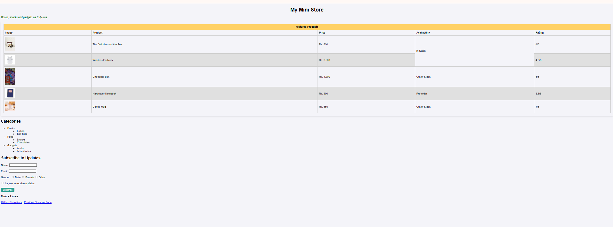

# My Mini Store

A one-page storefront that sells five items we love: books, snacks and gadgets.
Products are shown in a styled table with price, availability and rating.

## Precedence check (Part 11)

- Tagline colour: green (#006400). This is the inline style on the tagline paragraph.
- Other p tags: dark red (#8b0000), from the internal CSS. They do not use the external #555.

Explanation: an inline style attribute has the highest priority because it is attached to the element itself. Internal (style block) and external (linked file) rules both target p, which has the same specificity, so the later rule wins. The internal style comes after the external link, so it overrides #555. Order of priority: inline > internal > external.

## Screenshot

